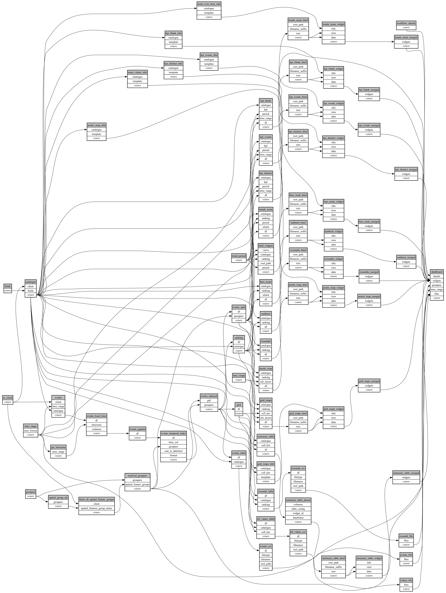

```
# AUTOGENERATED BY ECOSCOPE-WORKFLOWS; see fingerprint in README.md for details

```

```yaml
# fingerprint:
artifacts_sha256_basic: fc72b97d4f220c1ecbbfc25f23540b58ca645dddd10d7cff171a7ada698511e0
artifacts_sha256_strict: 41ba521e55fc29fff364675c71ad61adfae1cc099177741a11e96a06f8f8f20e
installed_requirements:
- channel: https://repo.prefix.dev/ecoscope-workflows/
  name: ecoscope-platform
  version: {version: ==2.26.0}
- channel: https://repo.prefix.dev/ecoscope-workflows-custom/
  name: ecoscope-workflows-ext-custom
  version: {version: ==0.1.2}
- channel: conda-forge
  name: pydeck
  version: {version: ==0.9.2}
- channel: https://repo.prefix.dev/ecoscope-workflows-custom/
  name: ecoscope-workflows-ext-wd
  version: {version: ==0.0.12}
params_sha256: 12f473d41de32b1dae5979736fa9d8a9f2ccf3a1f2e1e28b6a227d83cb9f7e46
spec_sha256: f03f59e16fde55c4b70c68e65ed0883f51849cd0acae264debc60cdc8f25b1f3

```

# ecoscope-workflows-categorical-workflow


