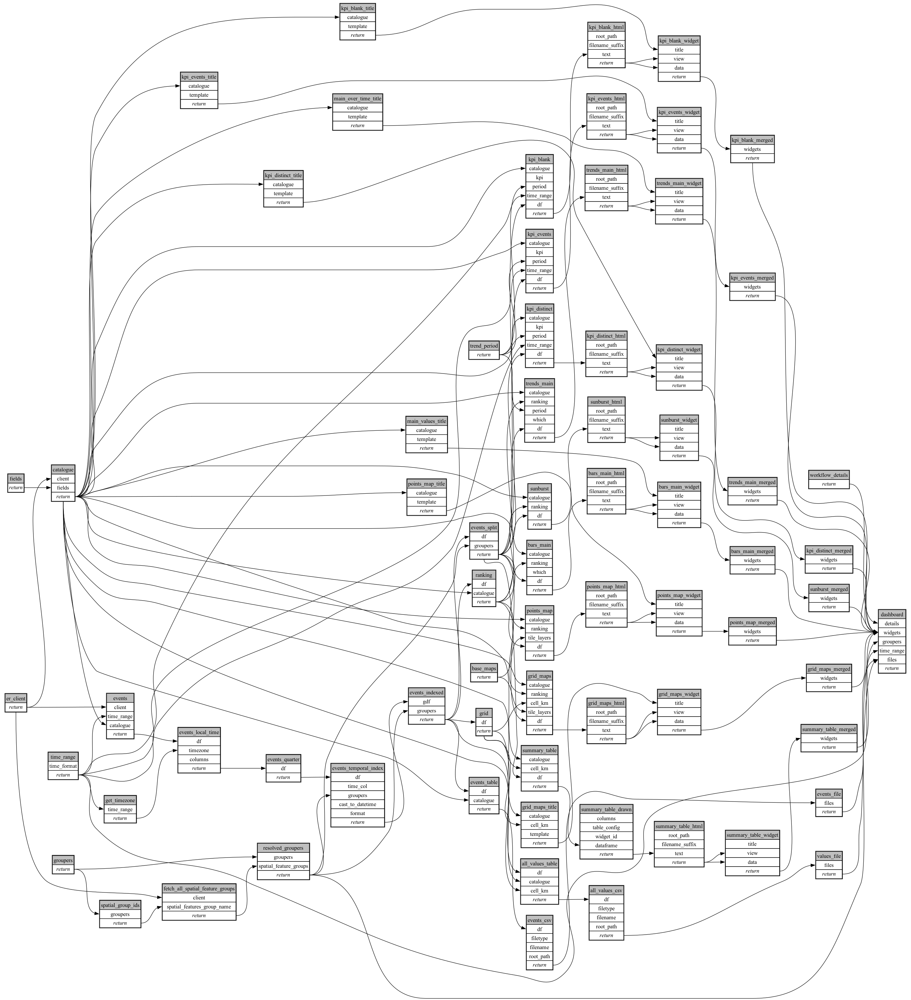

```
# AUTOGENERATED BY ECOSCOPE-WORKFLOWS; see fingerprint in README.md for details

```

```yaml
# fingerprint:
artifacts_sha256_basic: 7344c520fcb913680c830dd574d9a88ca2dd1df6d07b9653f26bb382ae5bf618
artifacts_sha256_strict: 1324c90f1bd5003cea53ba2c6dfb36e6db188de93609dbbb49f3548c395388dc
installed_requirements:
- channel: https://repo.prefix.dev/ecoscope-workflows/
  name: ecoscope-platform
  version: {version: ==2.31.0}
- channel: conda-forge
  name: pydeck
  version: {version: ==0.9.2}
- channel: https://repo.prefix.dev/ecoscope-workflows-custom/
  name: ecoscope-workflows-ext-wd
  version: {version: ==0.0.19}
params_sha256: aa656dfad20b39a4f4c999e2f35ca278eff09bfc93409fdbc082c7f43d7437da
spec_sha256: ae6b8c77b93c1fedb2b58435feacdf3ca8f27dae9b9222194679e0434222dca7

```

# ecoscope-workflows-categorical-workflow


