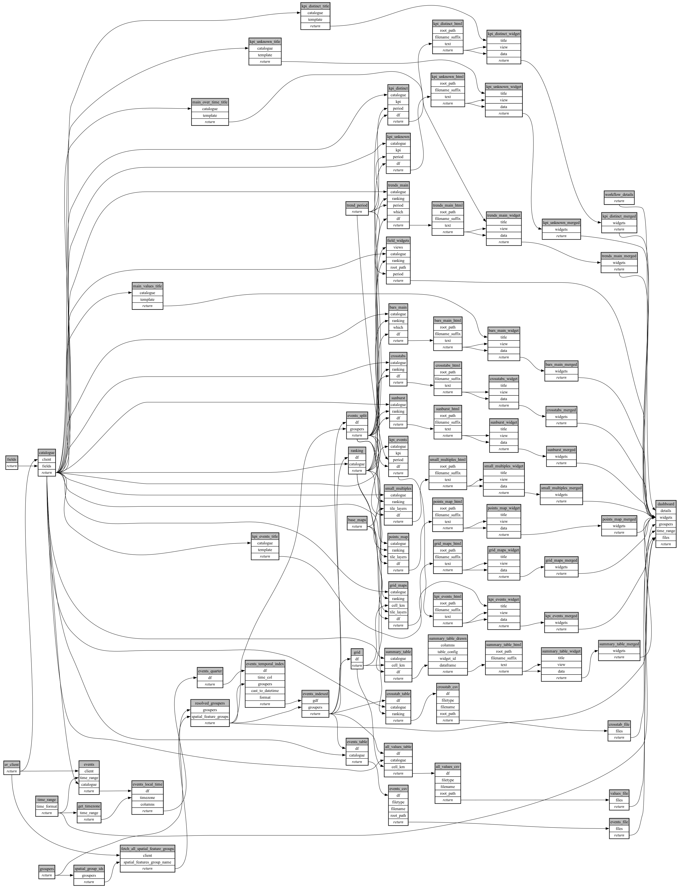

```
# AUTOGENERATED BY ECOSCOPE-WORKFLOWS; see fingerprint in README.md for details

```

```yaml
# fingerprint:
artifacts_sha256_basic: fd19b7e4e50293878de7e8d7de07c340994eaca1358d57b7ab6ebafa60424f36
artifacts_sha256_strict: 8ee4765bef37466612965ff689ce006b2d46549848ba0036452bd95a292543f1
installed_requirements:
- channel: https://repo.prefix.dev/ecoscope-workflows/
  name: ecoscope-platform
  version: {version: ==2.26.0}
- channel: https://repo.prefix.dev/ecoscope-workflows-custom/
  name: ecoscope-workflows-ext-custom
  version: {version: ==0.1.2}
- channel: conda-forge
  name: pydeck
  version: {version: ==0.9.2}
- channel: https://repo.prefix.dev/ecoscope-workflows-custom/
  name: ecoscope-workflows-ext-wd
  version: {version: ==0.0.10}
params_sha256: 12f473d41de32b1dae5979736fa9d8a9f2ccf3a1f2e1e28b6a227d83cb9f7e46
spec_sha256: 442edac28c8d9cd6ff469182ddfd5f0509fad3a1725d0e2c561d6940b9ae95f0

```

# ecoscope-workflows-event-details-categorical-workflow


